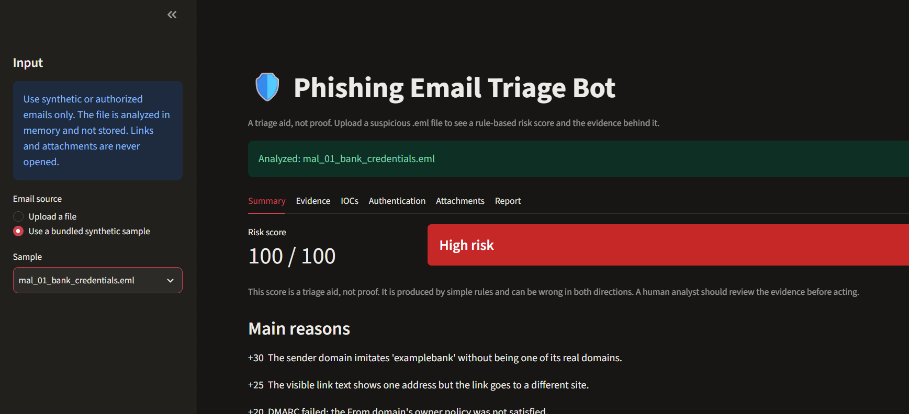
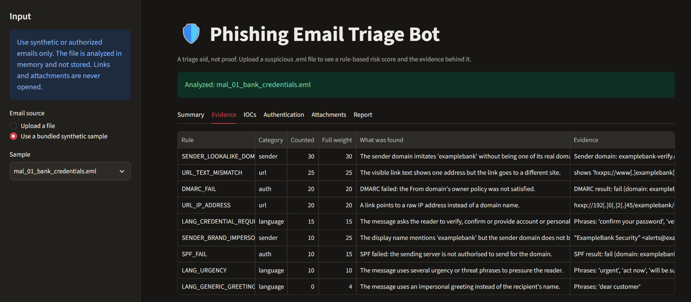
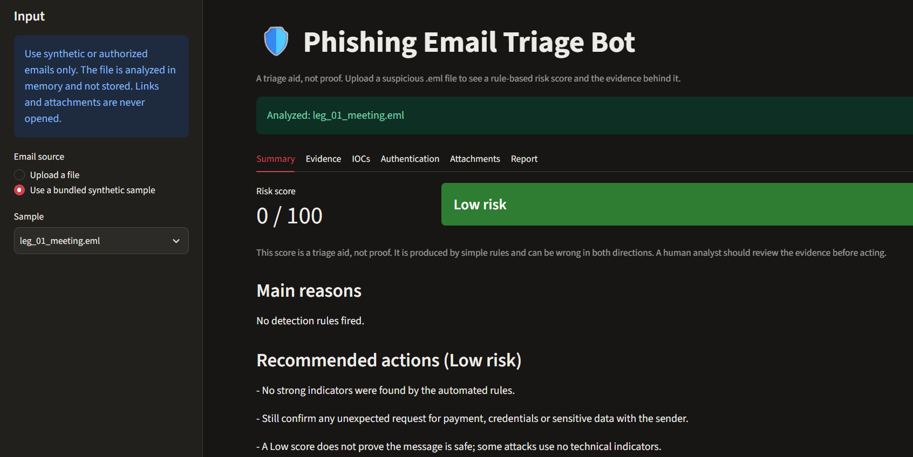
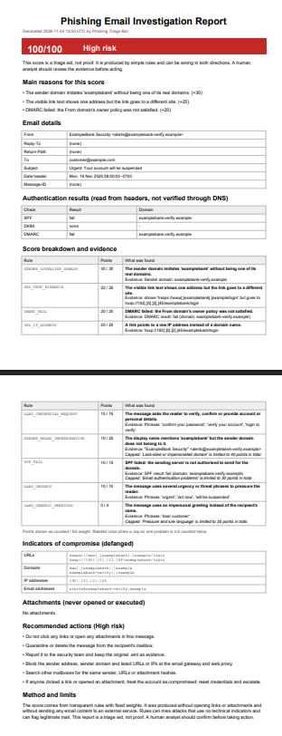
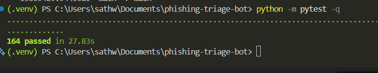
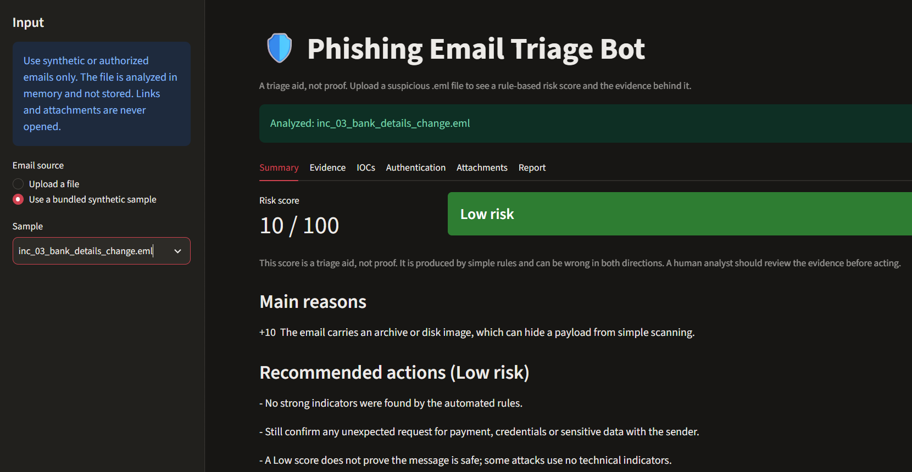

# AI-Powered Phishing Email Triage Bot

A Python tool that analyzes a suspicious `.eml` file, extracts indicators of compromise (IOCs), and produces a transparent, rule-based 0 to 100 risk score with the evidence behind every point. It includes a Streamlit dashboard and a downloadable PDF investigation report.

> **This is a triage aid, not proof.** The score comes from simple, documented rules. It can be wrong in both directions, and a human analyst should review the evidence before acting.



## What it does

- **Parses `.eml` files safely:** sender, recipients, subject, date, body, headers, attachment names and SHA-256 hashes
- **Extracts IOCs:** URLs, domains, IP addresses, email addresses and attachment hashes, displayed defanged (`hxxp://evil[.]example`)
- **Detects phishing indicators:**
  - *Sender:* display name vs real address, Reply-To mismatch, brand impersonation, look-alike domains
  - *Authentication:* SPF, DKIM and DMARC results read from the `Authentication-Results` header
  - *URLs:* shorteners, IP-based links, link text that does not match the real destination, suspicious TLDs, punycode, embedded credentials
  - *Language:* credential requests, urgency, prize or money lures, generic greetings
  - *Attachments:* executables, double extensions (`invoice.pdf.exe`), macro documents, HTML files, archives, hidden Unicode characters
- **Scores transparently:** configurable weights, per-group caps so one problem is not counted twice, Low / Medium / High classification
- **Shows its work:** every finding lists the exact evidence and the points it added
- **Generates a PDF investigation report:** summary, score breakdown, authentication results, IOCs, attachment hashes and recommended actions

## Screenshots

| Evidence table | Low-risk email |
|---|---|
|  |  |

| PDF report | Tests |
|---|---|
|  |  |

## Quick start (Windows PowerShell)

```powershell
git clone https://github.com/sathwika-net/Phishing-triage-bot.git
cd Phishing-triage-bot
python -m venv .venv
.\.venv\Scripts\Activate.ps1
pip install -r requirements.txt

python scripts\generate_samples.py      # builds the synthetic sample emails
streamlit run app.py                    # opens the dashboard
```

In the dashboard, choose **Use a bundled synthetic sample** or upload your own `.eml` file.

Command-line tools:

```powershell
python -m triage.scorer samples\quick_test.eml                          # score and per-rule breakdown
python -m triage.report samples\quick_test.eml reports\quick_test.pdf   # PDF report
python -m triage.evaluate                                               # run the labelled evaluation
python -m pytest                                                        # run the test suite
```

## How it works

```text
.eml bytes -> parser -> IOC extraction + auth parsing -> detectors -> scorer -> dashboard / PDF
```

1. **Parser** reads the file with Python's standard `email` library and extracts fields tolerantly, recording warnings instead of crashing.
2. **Detectors** each return `Finding` objects with a rule ID, a description and the exact evidence.
3. **Scorer** gives each rule a weight from `scoring_config.py`. Rules that describe the same problem (for example a look-alike sender domain and a look-alike link domain) share a group cap, so one problem cannot be counted several times. The total is limited to 100 and classified as Low (0-29), Medium (30-59) or High (60-100).
4. **Dashboard and report** present the result. The scorer only sees findings, never the email itself, so the same findings always give the same score.

## Project structure

```text
app.py                  Streamlit dashboard
triage/
  models.py             data classes (ParsedEmail, Finding)
  parser.py             safe .eml parsing
  extractors.py         IOC extraction and defanging
  auth.py               SPF / DKIM / DMARC parsing
  detectors.py          sender and URL detectors
  content_checks.py     language and attachment detectors
  engine.py             runs all detectors
  scoring_config.py     weights, groups and thresholds (edit here to tune)
  scorer.py             findings -> 0-100 score and level
  pipeline.py           parse -> detect -> score in one call
  report.py             PDF report (ReportLab)
  evaluate.py           measures the tool on the labelled dataset
scripts/
  generate_samples.py   builds the synthetic dataset
  fix_bidi.py           replaces hidden direction characters in source files
samples/                synthetic example emails
tests/                  pytest suite (142 tests)
.streamlit/config.toml  10 MB upload limit, usage statistics off
```

## Evaluation (measured, small, synthetic)

The tool was run on 9 invented emails: 3 clearly malicious, 3 legitimate business emails and 3 suspicious-but-inconclusive. The expected level for each email was written before the tool was run, and weights were not tuned afterwards.

| Result | Count |
|---|---|
| Malicious emails rated High | 3 of 3 |
| Legitimate emails rated Low | 3 of 3 |
| Inconclusive emails matching the expected Medium | 0 of 3 |

The three misses are informative:

- A message with only weak signals (Reply-To mismatch plus a link shortener) scored 26, Low.
- A parcel-delivery look-alike scored 62, High, where a reviewer might expect Medium.
- A business-email-compromise style message (a request to change bank details) passed SPF, DKIM and DMARC, came from a plausible sender and contained no suspicious link, so it scored 10, Low. Rules based on technical indicators cannot catch a message that is harmful only because of what it asks the reader to do.



The dataset is small and was written by the same author as the rules, so this is a sanity check and **not an accuracy claim**. Reproduce it with `python -m triage.evaluate`.

## Security design

- Never opens URLs and never executes or opens attachments (hashes are computed in memory only)
- Email content is treated as untrusted input, with limits on file size (10 MB), text length and IOC counts
- Only the topmost `Authentication-Results` header is trusted, and parenthetical comments are stripped so an attacker cannot inject a fake `spf=pass`
- The dashboard shows email text with `st.text`, `st.code` and `st.dataframe` only, never as markdown, so a hostile email cannot render a remote image or a clickable link
- The PDF escapes all email-derived text and omits the message body
- Uploads are read in memory, never written to disk, and capped at 10 MB at the server
- Synthetic data only: example domains use `.example` and IPs use the documentation range `192.0.2.0/24`
- No API keys or external services are used. No email content leaves the machine.

### Security review

I reviewed the code with `bandit` and a set of hostile inputs (huge URLs, nested HTML, thousands of attachments, deeply nested MIME, comment-bomb headers, binary garbage). Findings and fixes:

- **Regex denial of service:** the email-address pattern was quadratic on input like 200 KB of `a.a.a.`, taking about 30 seconds on my machine. Fixed by bounding the pattern, and covered by regression tests.
- **Hidden bidirectional characters in source files** ("Trojan Source" risk): replaced with visible escapes, and a test now fails if any return.
- **Upload limit applied too late:** Streamlit accepted 200 MB before the app check ran. Added a server-level 10 MB limit.
- **Parse errors displayed as markdown:** now shown as literal text.

This was a self-review with automated scanning, not a formal audit.

## Known limitations

- Domain matching is simplified (no Public Suffix List)
- Brand, TLD and shortener lists are small and editable, not exhaustive
- Heuristics can produce false positives, for example on legitimate tracking redirects
- SPF and DKIM are read from headers, not verified through DNS or cryptography
- Does not detect social-engineering messages that use no technical indicators (see the evaluation above)
- Tested only on synthetic emails

## Roadmap

- [x] Parser, IOC extraction, detectors, scoring, evaluation
- [x] Streamlit dashboard and PDF report
- [x] Security review and hostile-input tests
- [ ] Optional LLM explanation layer (off by default; no email content sent externally unless enabled)
- [ ] Payment-change and BEC language rules
- [ ] Larger evaluation set, including authorized real-world samples
- [ ] Public Suffix List for accurate domain matching
- [ ] Optional DNS-based SPF / DKIM verification
